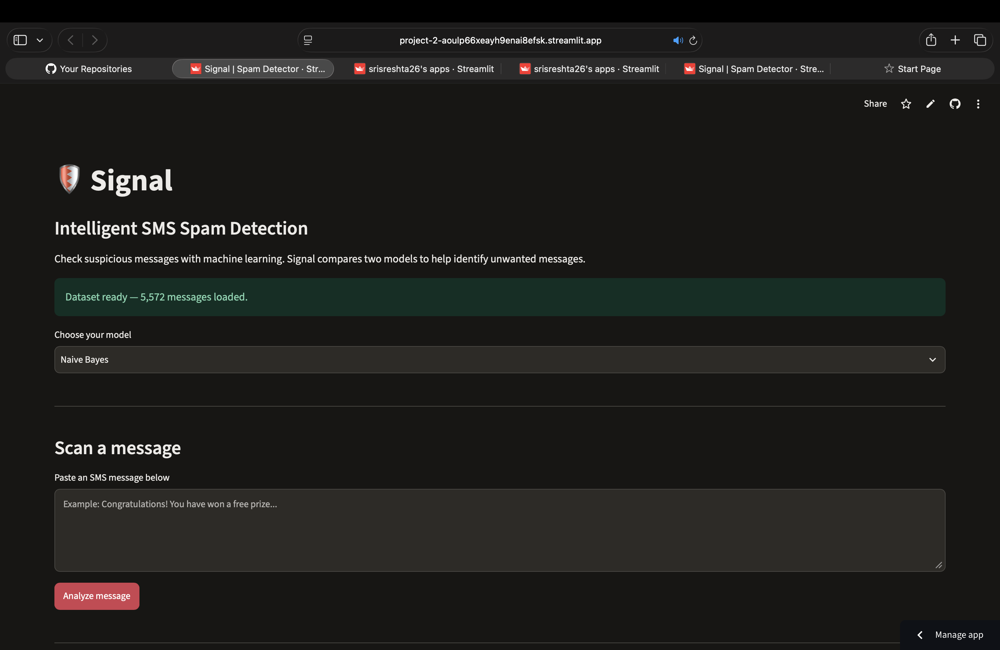
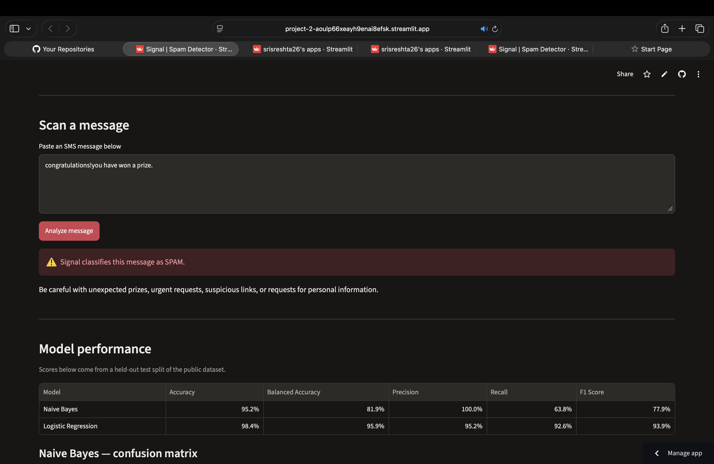

# Signal – SMS Spam Detection

An end-to-end Machine Learning project that classifies SMS messages as **Spam** or **Ham (Not Spam)** using Natural Language Processing (NLP).

## 🚀 Live Demo

[Try Signal – SMS Spam Detector](https://yh9enai8efsk.streamlit.app/)

## 📌 Project Overview

Signal is a machine learning application designed to identify unwanted or fraudulent SMS messages.

Users can enter a message and receive a prediction indicating whether it is spam or legitimate.

## ✨ Features

- SMS spam classification
- Interactive Streamlit web application
- Text preprocessing using NLP techniques
- Machine Learning model predictions
- Easy-to-use interface

## 🧠 Machine Learning

The project uses:
- Naive Bayes
- A second classification model (see implementation in `src/`)

## 📊 Dataset

The project uses an SMS Spam Collection dataset containing 5,572 messages.

## 🛠️ Technologies Used

- Python
- Pandas
- NumPy
- Scikit-learn
- Natural Language Processing (NLP)
- Streamlit

## 📁 Project Structure

```text
signal-sms-spam-detector/
│
├── app.py
├── requirements.txt
├── README.md
├── .gitignore
│
├── src/
├── scripts/
└── tests/
```

## 💻 Run Locally

Clone the repository:

```bash
git clone https://github.com/srisreshta26/signal-sms-spam-detector.git
```

Navigate into the project:

```bash
cd signal-sms-spam-detector
```

Install dependencies:

```bash
pip install -r requirements.txt
```

Run the application:

```bash
streamlit run app.py
```

## 🎯 Project Goal

To demonstrate how Machine Learning and NLP can be used to identify spam messages and build an accessible, interactive prediction application.

---

**Developed as an AI/ML portfolio project.**
## 📸 Screenshots

### Home Page


### Spam Detection Result

## ⚙️ Technical Implementation

### 1. Dataset

Signal uses the **SMS Spam Collection Dataset** from the UCI Machine Learning Repository.

The dataset contains SMS messages labelled as:
- `ham` – Normal messages
- `spam` – Unwanted or promotional messages

The dataset is downloaded automatically if it is not already available locally.

### 2. Data Preprocessing

The data preparation pipeline performs:
- Missing value removal
- Label standardisation
- Removal of invalid labels
- Empty message removal
- Dataset validation

### 3. Feature Extraction

**TF-IDF (Term Frequency–Inverse Document Frequency)** converts text messages into numerical features that machine learning models can understand.

Configuration:
- Lowercase text conversion
- Unicode accent stripping
- Unigrams and bigrams
- Maximum of 30,000 features
- Sublinear term frequency scaling

### 4. Machine Learning Algorithms

Signal trains and compares two classification algorithms:

**Multinomial Naive Bayes**
- A probabilistic classification algorithm.
- Commonly used for text classification.

**Logistic Regression**
- A supervised classification algorithm.
- Uses balanced class weights to account for class imbalance.

### 5. Model Training and Evaluation

The dataset is divided into:
- 80% training data
- 20% testing data

Stratified splitting is used to preserve class proportions.

Models are evaluated using:
- Accuracy
- Balanced Accuracy
- Precision
- Recall
- F1-score
- Confusion Matrix
- Classification Report

### 6. Application

The application is built using Streamlit and provides:
- Interactive model selection
- SMS message classification
- Model performance comparison
- Confusion matrix visualisation
- Classification report display

### 7. Limitations

- Predictions may not always be correct.
- The models are trained on a specific SMS dataset.
- A normal classification does not guarantee that a message is safe.

## 🚀 Future Improvements

- Explore additional machine learning algorithms.
- Improve model performance through hyperparameter tuning.
- Expand the training dataset.
- Explore more advanced NLP techniques.
- Improve the user interface and visualisations.
## 🧪 Testing

Signal includes automated tests using **pytest**.

The test suite checks:
- Successful dataset loading and validation.
- Successful training of both machine learning models.
- Model prediction functionality.
- Valid prediction labels and output lengths.

### Running Tests

```bash
python -m pytest -v
```

### Latest Test Results

- Total tests: 2
- Passed: 2
- Failed: 0

All automated tests passed successfully.